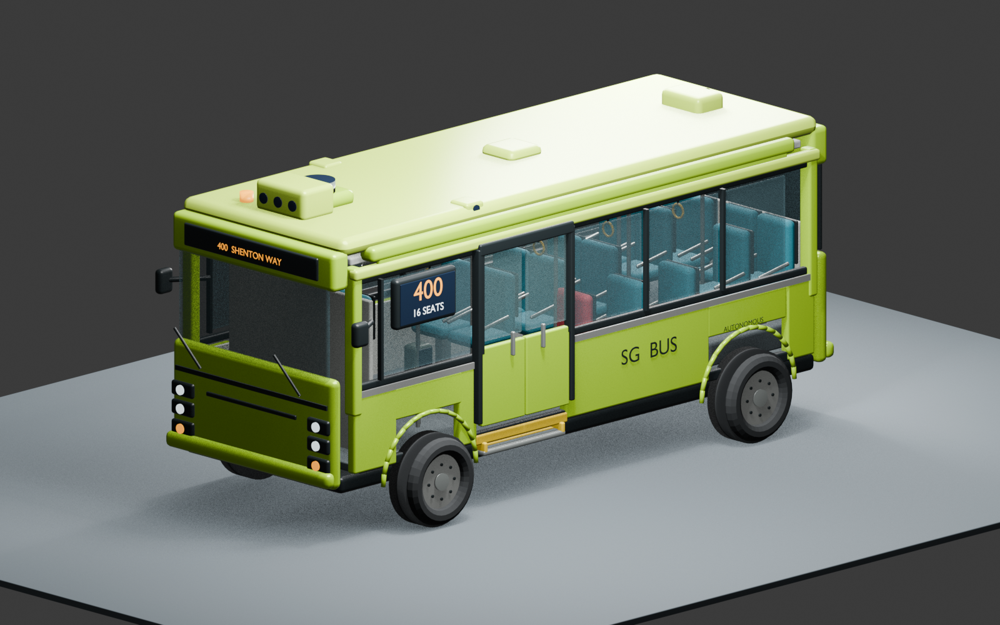
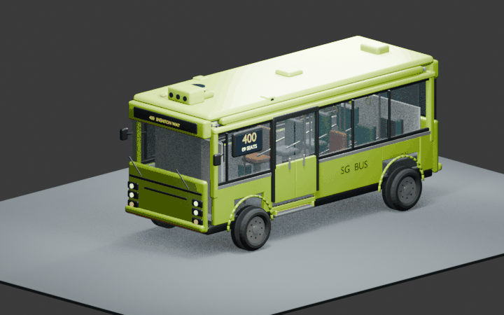

# AV Bus Blender Kit

A reusable, scripted Blender concept bus for animation. It includes 16 passenger seats, a separate safety-operator seat, an entrance-side wheelchair-bay marking, a side route/seat display, and stop sequences with opening doors, a deployable ramp, and an optional rain canopy.

This visual asset was created for NTU Team 1's video demonstration for the **Singapore BusTech Grand Challenge (SGBTGC) 2026**. It is an independent student concept, not an official LTA, operator, or manufacturer model. Singapore is piloting autonomous public-bus services; this bus should not be mistaken for the vehicle selected for those services.

## What is included

| File | Purpose |
| --- | --- |
| `build_av_bus.py` | Creates the bus and named animation controls. |
| `animate_stop_ramp.py` | Animates approach, stop, doors, ramp, stowage, and departure. |
| `animate_stop_ramp_canopy.py` | Adds canopy deployment to the stop sequence. |
| `README_AV_BUS.md` | Detailed setup, controls, and shot-making guide. |
| `AV_Bus_Master.blend` | Clean, unanimated sample scene. |
| `demo.gif` | Short motion preview. |
| `preview.png` | Still preview of the bus. |

Keep the three Python files in the same folder. To build from scratch, open Blender's Scripting workspace in a fresh scene and run `build_av_bus.py`. To use the supplied scene, open `AV_Bus_Master.blend`; run **one** of the two animation scripts in a fresh copy. The two variants should not be run over one another. See [the full usage guide](README_AV_BUS.md) for command-line examples, scene controls, and timing.

Tested with Blender 5.2.2 LTS. The geometry, seating, sensor details, and ramp/canopy mechanisms are illustrative. The ramp is **not** an accessibility-certified design, and this kit is not suitable for fabrication, vehicle engineering, or operational safety decisions.

## Project background

Singapore's Land Transport Authority has announced pilot deployment of autonomous buses on public services 400 and 191. This kit visualises a student team's own bus concept for storytelling; it does not reproduce official CAD or make claims about the configuration of a deployed vehicle. [LTA pilot announcement](https://www.lta.gov.sg/content/ltagov/en/newsroom/2025/10/news-releases/lta_awards_contract_pilot_deployment_autonomous_buses.html).

## Sharing status

This repository is being prepared privately for a possible post-competition release. **No reuse license has been selected yet.** Until one is added, please do not assume permission to redistribute or adapt the files outside the team. Before making the repository public, the team should agree on authorship/permission, check the competition rules, and select a license if open reuse is intended.

No third-party reference photos, videos, or official logos are included.
