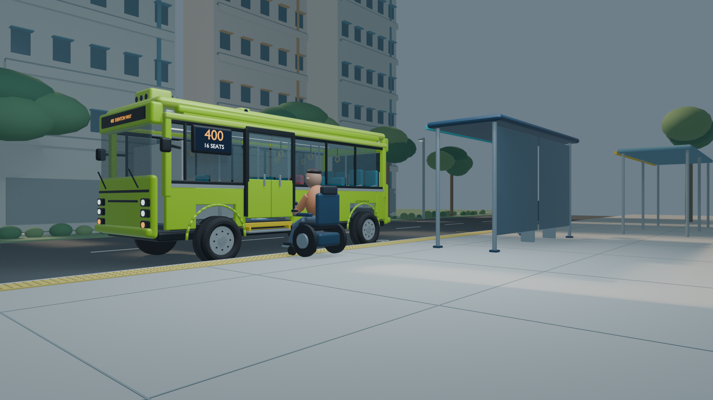
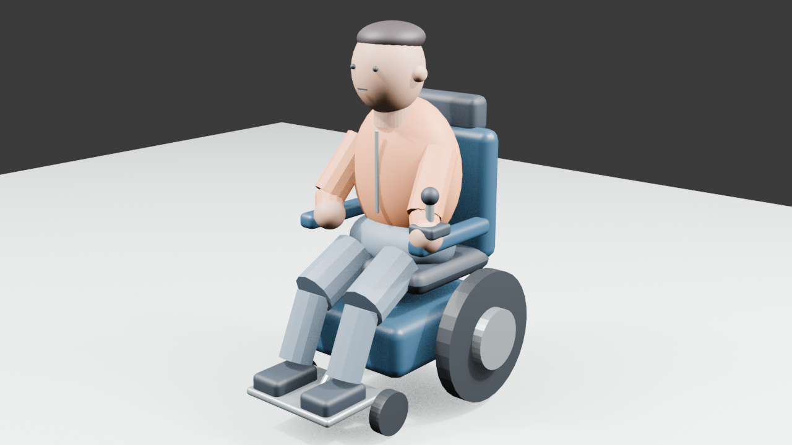
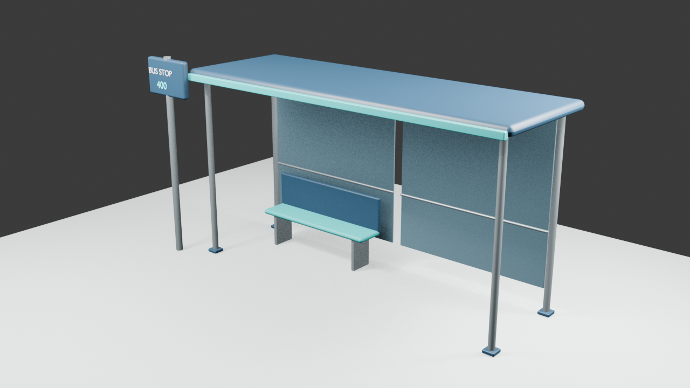
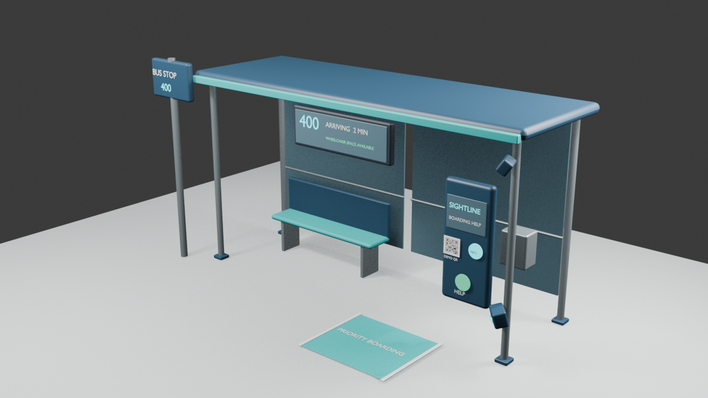
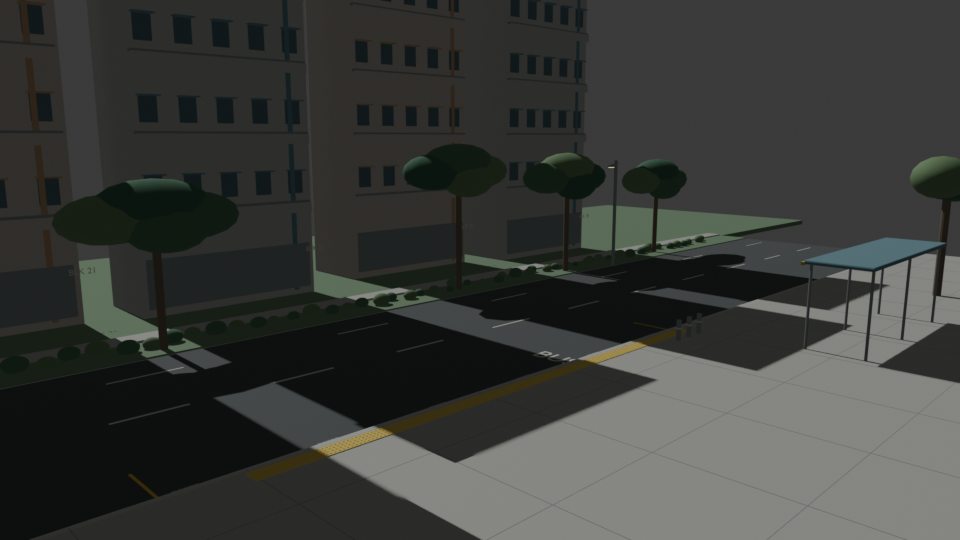
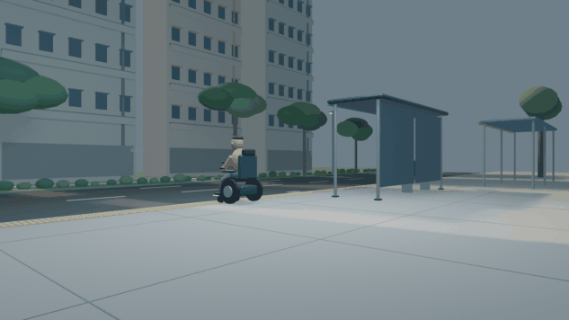
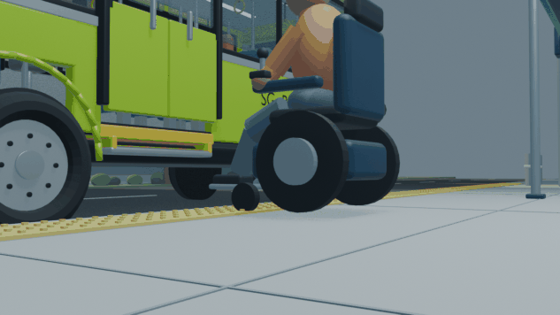

# SightLine — AV Bus Blender Kit

**NTU Team 1 · Singapore BusTech Grand Challenge 2026 · Blender 5.2**

A reusable, stylized autonomous-bus concept and scene kit made for our team's three-minute accessibility story. This repository now follows the work from the **bus model**, through the **rider, before/after stops and Singapore-inspired street set**, to the first two animated shots.

**Watch the current sequence:** [Shots 1–2 · 1080p MP4](shots/renders/1-2.mp4) · [Open the editable 1–2 Blender timeline](shots/renders/1-2.blend) · [Browse all scene files](shots/)

The 12-second sequence is **1920 × 1080, 24 fps, 288 frames**. It is a silent work-in-progress render; sound, captions and editorial overlays will be added in the film edit. The MP4 is a video export, while `1-2.blend` contains both original animated scenes on a single Blender timeline and needs no external movie file.

## From assets to story

| Stage | What is here now |
| --- | --- |
| **01 · Bus** | A 16-passenger-seat concept with an empty safety-operator seat, a marked wheelchair bay, side route/seat display, opening doors, deployable ramp and optional rain canopy. |
| **02 · Rider and stops** | A generic stylized wheelchair user, an ordinary **before** shelter and a separate SightLine **after** shelter with arrival display, help panel and priority boarding zone. |
| **03 · Singapore-inspired set** | Road, 15 cm kerb, tactile paving, bus-bay markings, housing façades, tropical trees and street furniture. |
| **04 · Shots 1–2** | The bus arrives; then the doors open to reveal a gap and raised entry that prevent boarding. The ramp stays stowed in this **before** sequence. |

### The bus and rider

| AV bus concept | Generic rider, “Albie” |
| :---: | :---: |
|  |  |
| [Bus `.blend`](AV_Bus_Master.blend) · [model guide](README_AV_BUS.md) · [doors/ramp/canopy GIF](demo.gif) | [Rider `.blend`](set-bundle/assets/Albie_Powered_Wheelchair.blend) |

### Two distinct bus stops

| Before — ordinary shelter | After — SightLine-equipped shelter |
| :---: | :---: |
|  |  |
| [Before `.blend`](set-bundle/assets/SightLine_Stop_Before.blend) | [After `.blend`](set-bundle/assets/SightLine_Stop_After.blend) |

The upgraded stop's QR code is a **demo linking to `https://example.com`**, not a live service. Replace it before publishing a final demonstration. The side-mounted camera and kerb sensor are visual concept components, not validated safety hardware.

### Reusable street set

[Open the street-set `.blend`](set-bundle/assets/Singapore_Street_Set_Master.blend) · [Read the asset-bundle guide](set-bundle/README.md)

## Watch the first two shots

| Shot 1 · Arrival | Shot 2 · The gap |
| :---: | :---: |
|  |  |
| [1080p MP4](shots/renders/s01_bus_arrival_1080p24.mp4) · [editable scene](shots/s01_bus_arrival_v05.blend) | [1080p MP4](shots/renders/s02_bus_gap_1080p24.mp4) · [editable scene](shots/s02_bus_gap_v05.blend) |

The GIFs are **small, sparsely sampled motion reviews**; use the MP4s for playback and the `.blend` files for editing. See the [shots guide](shots/README.md) for frame ranges and render notes.

## Find the right file

| Location | Purpose |
| --- | --- |
| [`build_av_bus.py`](build_av_bus.py) | Rebuild the bus model and named animation controls. |
| [`animate_stop_ramp.py`](animate_stop_ramp.py), [`animate_stop_ramp_canopy.py`](animate_stop_ramp_canopy.py) | Two alternative stop-motion demonstrations. Run either one on a fresh bus scene. |
| [`AV_Bus_Master.blend`](AV_Bus_Master.blend) | Clean bus model for appending into new scenes. |
| [`set-bundle/assets/`](set-bundle/assets/) | Five reusable `.blend` assets: bus, rider, before stop, after stop and street set. |
| [`set-bundle/scripts/`](set-bundle/scripts/) | Procedural builders and helpers used to create the reusable assets. |
| [`shots/`](shots/) | The two current shot scenes, review GIFs, 1080p exports and combined timeline. |

To make a new scene, open Blender 5.2 and **File → Append** the relevant asset collection, then move its root object (`AV_BUS_ROOT`, `ALBIE_ROOT`, `STOP_ASSET_ROOT` or `SG_SET_ROOT`). To review the current edit, open [`shots/renders/1-2.blend`](shots/renders/1-2.blend) and use the **Video Sequencer** timeline: Shot 1 occupies frames **1–144**, Shot 2 frames **145–288**. The two shot scenes have appended assets, so they do not depend on links to the set-bundle folder. For bus controls and command-line examples, use the [full bus guide](README_AV_BUS.md).

## Project status and use

This is an **independent student visual concept** for NTU Team 1's Singapore BusTech Grand Challenge 2026 video, not an official LTA, bus-operator or manufacturer model. Geometry, seating, sensing, ramp and canopy mechanisms are illustrative; the ramp is **not accessibility-certified**, and nothing here should be used for fabrication or operational safety decisions. Route numbers and housing signs are demo scenery.

The repository is being prepared privately for a possible post-competition release. **No reuse license has been selected yet**; do not assume permission to redistribute or adapt these files outside the team. No third-party reference photographs, videos or official logos are included.
